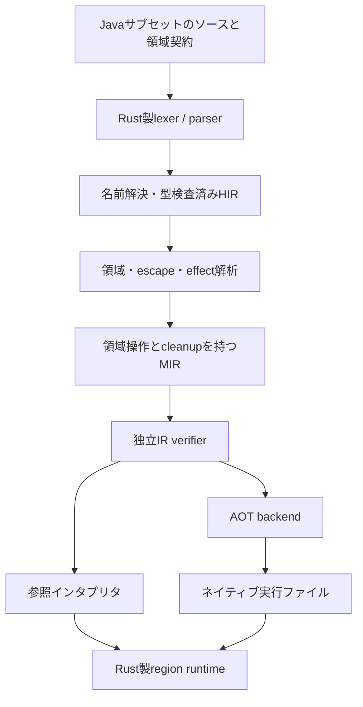

# Rustによる実装計画

[提案概要](README.md) / [メモリモデル](memory-model.md)

本書のcrate、コマンド、IR、テストは実装予定であり、既存の実装や測定結果ではない。提案作成時点のリポジトリにはコードがないため、まず仕様と検証可能な最小系を作る。

## 1. 全体構成



JVMやjavacの内部表現を実行基盤にしない。Rustソースへの単純な変換も主経路にしない。Java式の可変alias、仮想呼出し、独自の例外・領域規則をRustの通常参照へ直接写すと、意味論が借用検査や生成コードの都合に引きずられるためである。

最初はchecked handleを使うMIRインタプリタを正しさの参照実装にする。AOT backendの第一候補はRust製のCraneliftとし、object出力、プラットフォームABI、ランタイムとのリンクを小さな試作で確認してから依存を固定する。Craneliftは独自フロントエンドのIRから機械語を生成する用途とAOT利用を想定したbackendである。[Cranelift公式](https://cranelift.dev/)

初期ターゲット案は開発環境に合わせた`x86_64-pc-windows-msvc`の一つに絞る。最初に型、整数ABI、構造体戻り値、status付き例外伝播、デバッグ情報、静的ランタイムリンクの疎通を確認する。別OS・別CPUやLLVM backendは、この確認後の拡張とする。

## 2. Cargo workspace案

```text
crates/
  rava-cli/          check / build / run / explain-region
  rava-syntax/       字句解析、構文解析、span付きAST
  rava-hir/          名前解決、型、型付きHIR
  rava-analysis/     region制約、escape、effect要約
  rava-mir/          CFG、cleanup lowering、独立verifier
  rava-interp/       checked handleによる参照実行器
  rava-codegen/      Craneliftへのlowering、object出力
  rava-runtime/      領域、copy、error、resource、channel
  rava-metadata/     型descriptor、契約・ABIの版管理
  rava-import/       source jar・資源・対応API検査（後段）
stdlib/             Rava向けの小さな標準ライブラリ
tests/
  compile-pass/     許可するプログラム
  compile-fail/     拒否理由を含む診断fixture
  runtime/          メモリ、コピー、例外、通信
  differential/     参照実行器 / AOT / 共通Javaサブセット
  stress/          反復要求、割当失敗注入、巨大グラフ
```

実装初期はcrateをまとめてもよいが、解析済みIRとruntimeの責任境界は維持する。構文parserの採用判断は対象サブセットの適合試験で行い、汎用parserが受理したことをRavaで実行可能な根拠にしない。依存版とRust toolchainは実装開始時に固定する。

## 3. IRに残す情報

HIRは通常の型に加え、割当領域、参照の利用期間、値型・参照型・resource型の区別、メソッド効果を持つ。型消去や仮想呼出しのloweringで領域情報を消さない。

MIRでは、次の操作を明示する。

| 操作 | 保持する意味 |
| --- | --- |
| `region_enter(parent, budget)` | 新しい動的領域を開始 |
| `alloc(type, region)` | 非移動オブジェクトを領域に割当 |
| `load(handle, field)` / `store(handle, field, value)` | 型と参照の寿命条件を伴うアクセス |
| `call(target, region_args, args)` | 検証済み契約を持つ呼出し |
| `copy_value` / `copy_graph(src, dst)` | 値コピーと明示的なグラフコピー |
| `make_error` / `raise` | 所有packetと例外継続先 |
| `resource_register` / `resource_close` | 外部資源の所有とcleanup |
| `send_copy` / `receive_into` | キュー所有への変換と受信領域への復元 |
| `region_exit` | 子・資源のcleanup後に領域を破棄 |

verifierは領域の開始・終了の整合、全CFG出口のcleanup、使用時の領域生存、storeのoutlives条件、参照返却契約、例外packet所有を検査する。最適化後にも再検査する。反射のように動的な情報が必要な箇所は、検査命令が支配することを要求する。

対象言語の評価順はHIRの段階で固定する。最初のJava互換部分では、32/64bit整数のwrapping、shift幅、整数の0除算、最小値と`-1`の除算、nullと配列境界、UTF-16の`char`、浮動小数点のNaN等を個別に実装する。Rustのdebug/releaseの挙動差や`char`、panicにそのまま依存しない。

オブジェクトは型ID、領域ID、同一性のためのID、フィールド領域を持つ。仮想呼出し用の型descriptorをAOT生成し、継承・interfaceの対応表を不変メタデータに置く。型の初期化とコンストラクタの順序、部分初期化された`this`の外部公開禁止も検査する。

genericsは最初は不変で、必要な特殊化を生成する。型と領域の特殊化数には上限と診断を設ける。無限に増殖する特殊化を許さず、領域の実行時capabilityとコードの型特殊化を分ける。

## 4. ランタイム

### 4.1 最初は検査付きhandle

初期の参照は概念的に`{thread_id, region_id, generation, object_id}`を持つhandleとし、アクセス時に生存・所有・型を検査する。領域再利用後に古いhandleが有効になることを世代番号で防ぎ、番号の桁あふれは再利用禁止または明示的エラーにする。

インタプリタではRustの所有コンテナにオブジェクトを置き、load/storeごとに短い借用を行う。対象言語のメソッド呼出しやコールバックを跨いでRustの`&mut`を保持しない。aliasのあるオブジェクトを引数に二度渡しても、Rustの複数可変参照に変換しない。

AOTの最初の実装もhandle経由のruntime操作で動かし、正しさを揃えてから直接アクセスを追加する。参照同一性はhandleの指すオブジェクトIDで実装する。コピーする非定数オブジェクトは新しいIDとし、共有する不変定数のIDは保つ。`identityHashCode`を提供する場合も、同一性とhash衝突を区別する。

### 4.2 arenaと所有

領域ごとに移動しないchunkを持つbump allocatorを使う。領域はchunk一覧、親ID、所有スレッド、割当予算、cleanup登録、統計を所有する。割当時のalignmentとsizeの加算・乗算はoverflowを検査する。

普通のオブジェクト・配列のpayloadは、可能な限り同じ領域のメモリだけで完結させる。別のRust heap割当を所有するruntime値には個別のdrop登録を要求する。論理的な領域の解放と、ページを再利用するpoolの寿命を別々に管理する。

領域終了ではユーザーの到達可能性を走査しない。専用cleanup登録を処理してchunkを返す。計算量はchunk数とcleanup登録数に依存し、常に`O(1)`とは主張しない。一般オブジェクトごとの破棄処理が必要にならないレイアウトを優先する。

グラフコピーはdestinationに追加可能な非公開batchへ構築する。対応表と走査キューは操作が所有し、成功・失敗のどちらでも破棄する。allocation failureを各段階に注入し、部分グラフの公開、二重cleanup、予算超過がないことを確認する。

### 4.3 unsafeの範囲

直接アクセス最適化を入れる場合も、raw pointerとhandleの変換、alignment、境界、メタデータ解釈を狭いruntimeモジュールに集める。Java式の可変aliasを長寿命の`&T`や`&mut T`として公開しない。`UnsafeCell`を使っても複数のaliasする`&mut`が許されるわけではない。[Rust Referenceの未定義動作](https://doc.rust-lang.org/stable/reference/behavior-considered-undefined.html)、[Rustのinterior mutability](https://doc.rust-lang.org/reference/interior-mutability.html)

対象言語のメモリはスレッド所有とし、Rust APIでも誤って`Send`・`Sync`を実装しない。スレッド間で渡す型は、参照アドレスを含まない検証済みmessageと専用同期ハンドルに絞る。FFI・コード生成のABIにはRustネイティブの構造体レイアウトを露出せず、固定したC互換レイアウトを使う。

unsafe追加時には、入力の前提、保持できる参照期間、再入可能性、解放条件をコード近傍に記述する。静的に受理されたという理由だけで、backendが任意のRust参照を構築できるとはしない。

## 5. 標準ライブラリと取り込み

標準ライブラリは既存JDKを丸ごと移植せず、プリミティブ演算、String、配列、容量付きList/Map、値DTO、基本I/O、scope、copy、error、worker/channelから作る。戻り値の領域やreceiverへの保存契約を各APIに含める。

List/Mapには、要素参照がコンテナより長寿命であることを要求する。Mapのキーは整数、真偽値、それらからなる値型、標準Stringに限定し、内容に基づく安定hashを使う。identityが変わるコピーによってbucketとキーの整合性が壊れる実装を避ける。削除とarenaメモリ解放は別であることをAPIにも記載する。Stringのリテラルと実行時生成を区別し、文字列結合・substringの返却領域を明示する。substringが大きな元バッファを予想外に保持する設計を避け、v0では選択範囲を指定領域へコピーする。

source jar取り込みは、ソース抽出、依存解析、禁止API検出、領域契約検証、通常コンパイルという経路にする。契約不明のnativeメソッドやクラスローダ依存を見つけたら、対象シンボルを示して拒否する。zip展開は指定出力先からのpath traversalを禁止し、展開量に上限を持たせる。

classインポータを作る場合は別crateとし、検証可能な命令のallowlistから始める。ソースがない状態で全オブジェクトをthread rootへ割り当てる方式を互換性対応として採用しない。JVM連携が将来必要なら、GCなしの同一runtimeとは区別された外部プロセス連携として扱う。

## 6. 実装段階と通過条件

工期を先に固定せず、下記の通過条件を満たしてから範囲を広げる。

| 段階 | 実装するもの | 通過条件 |
| --- | --- | --- |
| P0: 小さな意味論 | region木、store制約、明示scope、checked handleのモデル実行器 | 同一領域循環が解放され、親への短寿命参照・世代再利用が拒否される |
| P1: 単一スレッドの言語 | parser、型付きHIR、基本class・配列・制御構文、MIR実行器 | Javaとの共通部分の評価順・算術・alias/identityが一致する |
| P2: 境界の表現 | 関数契約、戻り値領域、値型、graph copy、制限付き例外とcleanup | copyが循環と共有を保存し、通常の脱出経路と回復可能な割当失敗・予算超過でcleanupが完了する |
| P3: 推論と多相 | escape解析、領域推論、再帰SCC、継承・interface、限定generics・クロージャ | override/cast/捕捉を含む不正escapeを拒否し、推論結果と原因を表示できる |
| P4: AOT | ABI試作、Cranelift lowering、native link、小さな標準ライブラリ | MIR実行器と同じ結果・失敗・領域統計になり、JVMを要せず実行できる |
| P5: 長時間実行 | worker、bounded channel、request scope、所有メッセージ | 送信元終了後の受信が正常で、反復要求の領域使用量が頭打ちになる |
| P6: 制限付き相互運用 | scoped reflection、型登録、source jar・資源取り込み | 反射escape・未登録型・禁止APIを拒否し、小規模ライブラリを再コンパイルできる |

P0〜P2を最初の継続判断点にする。必要な制限を設けても戻り値やコレクションが扱えない、エラー経路で寿命規則が破れる、コピーコストが用途の予算を満たせない場合は、互換範囲や対象用途を狭める。GCや無制限のroot昇格で試験だけ通すことはしない。

## 7. 必須の検証

### 7.1 許可・拒否の対になるfixture

| ケース | 期待する結果 |
| --- | --- |
| 同一領域の双方向リスト、循環グラフ | 実行可能、領域終了で全体解放 |
| 親のfieldに子領域の参照を保存 | コンパイルエラー |
| 親を子でaliasし、cast・Object・generic経由で同じ保存 | 同じくエラー |
| 配列・List・Map・クロージャ経由の短寿命保存 | エラー |
| 引数由来参照の返却、結果領域への直接構築 | 契約を満たせば許可 |
| 呼出し先local参照の返却、overrideで契約拡大 | エラー |
| 深いグラフ・循環・複数rootのcopy | 型と内部共有を保存、非定数オブジェクトは元とは異なるidentity |
| 不変定数をrootまたはfieldに持つcopy | 定数の共有とidentityを保持 |
| 安定hashキーを持つMapのcopy | コピー後の検索と内部共有が成立する |
| resourceを含むcopy、copy途中の予算枯渇 | 拒否または失敗、部分結果非公開 |
| throw元領域解放後のcatch | 所有packetにより情報が有効 |
| return / break / continue / throw / finally / close失敗 | cleanupが仕様通りの順序で一度だけ実行 |
| 通常参照のスレッド送信、mutable static | コンパイルエラー |
| 定数graphのfield更新、cast経由の更新 | コンパイルエラー |
| resource借用中のclose、close後の利用 | コンパイルエラー |
| 送信成功後に送信元スレッド終了 | 受信結果が有効 |
| queue満杯、キャンセル、受信失敗、未受信のまま終了 | 所有messageが残留しない |
| 送受信待機中のworker群の終了 | close・起床・joinの順序で待機が解除される |
| reflectionの外側receiverへのstore、別スレッドcapability | 操作前に拒否 |
| 未登録型、禁止効果を持つ反射メソッド | 登録時または呼出し前に拒否 |
| 同じソース位置の再帰scope・反復scope、古いhandle | 動的インスタンスと世代を正しく区別 |

### 7.2 健全性とruntimeの検証

小さな操作意味論で、(1)型と領域の制約を実行ステップが保存する、(2)領域削除後も存続可能な値に削除領域への参照がない、(3)読み書き対象の所有スレッドが一致する、を設計時に示す。最初からJava全体の形式証明を掲げず、P0の縮小言語から対象を拡張する。

実装には次の検証を組み合わせる。

- コンパイル成功・失敗fixtureと、エラー位置・理由のsnapshot。
- ランダムな領域木、参照操作、CFGに対するproperty testとfuzzing。
- 同じ検証済みMIRをインタプリタとAOTで実行する差分試験。
- 意味論が共通なJavaサブセットだけを固定JDKでも実行する差分試験。Rava独自の値型や例外をJava互換試験へ混ぜない。
- Rust runtimeの適用可能な部分にMiri、対応するターゲット・ツールチェーンでsanitizerを使う。生成機械語全体をMiriで検証できるとは扱わない。
- copy・例外・resource・messageの回復可能な各割当点への失敗注入。キャンセルと再入可能な呼出しを含める。fatal abortの経路はcleanup保証から分け、終了結果を確認する。

### 7.3 長時間実行と性能

固定サイズの成功・失敗要求を混在させて100万回処理する。単一要求の逐次試験では、各要求の終了後に`active_regions`、`live_region_bytes`、`owned_message_bytes`、`resource_count`が基準に戻ることを確認する。並列試験では要求別の所有カウンタを確認し、全体の基準復帰はメッセージをdrainし、workerが要求を完了またはjoinした静止点で判定する。固定のrootデータは基準値に含める。予約済みpoolが温まった後は、その上限を超えて増加しないことも確認する。

測定項目は、処理時間の分位点、コピー量・回数、copy作業領域のpeak、使用中・予約済みメモリ、領域破棄時間、資源close時間、コンパイル時間、特殊化数とする。RSSは補助指標にし、OSに返却されていないことを直ちにリークと見なさない。

ベンチマークは、小さな値の大量処理、循環AST、文字列・コレクション、明示copyによる返却、worker通信、登録型の反射、長寿命コンテナの追加削除を含める。最後のケースは弱点を隠さず、領域再構築や容量制限の効果を測る。

Javaとの比較では同じ仕事量・入力を使い、固定JDKとGC設定、JVMのウォームアップ、Ravaのコピー量を記録する。Rustによる手書きのarena版も比較対象にすると、言語処理系とメモリモデルそれぞれのコストを分離しやすい。速度優位をv0の必須条件にせず、想定用途でのメモリ上限と遅延予算を明示して評価する。

## 8. 後続に残す判断

v0で固定するのは領域の参照規則、通常classの同一性、明示copy、スレッド分離、closed-world reflectionである。以下は実測と使用例を得てから決める。

| 後続項目 | 解く必要がある問題 |
| --- | --- |
| 領域注釈・scopeの最終構文 | Javaソースの読みやすさと、寿命を説明できる診断 |
| 大きな値・所有文字列 | move/drop、boxing、generic、例外との整合 |
| 独立領域の一意所有による移譲 | 外部alias不存在の証明、受信後の所有者変更 |
| 長寿命の可変データ | 部分領域の再構築、世代管理、容量上限 |
| 共有不変オブジェクト | 動的に作った共有データの寿命所有者。安易なimmortal化はしない |
| classインポータ | 検証可能なbytecode/APIの範囲と変換コスト |
| async・タスク移動 | OSスレッドと所有ドメインの分離、停止中の領域寿命 |
| LLVM等のbackend | 性能・ツールチェーン・デバッグ情報・保守コスト |

まずP0の参照モデルと不正escapeのfixtureを作り、P1〜P2で小さなプログラムを最後まで動かす。それを安全性・互換性・メモリ保持の判断基準として、後続の推論や最適化を追加する。
